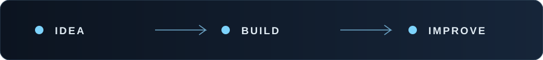

<!--
  Murat Aktaş — GitHub Profile README
  Design: Luxury Tech | Dark / Anthracite / Ice Blue
  Profile repository: https://github.com/Mur-47/Mur-47
  Private projects are described without linking to their source code.
-->

  

  

  
  
  

 

## About Me

I'm **Murat Aktaş**, a software developer with a focus on **backend engineering, practical software solutions, and SaaS products**. I'm building independently, improving my skills along the way, and working toward the long-term goal of establishing my own technology company.

I enjoy turning ideas into functional products, learning the systems behind them, and refining what I build through real-world problems.

> **I don't just want to write software. I want to build products, create meaningful solutions, and turn ambitious ideas into real businesses.**

<strong>🇹🇷 Türkçe profilimi görüntüle</strong>

 

### Hakkımda

Ben **Murat Aktaş**. Backend geliştirme, gerçek problemlere çözüm üreten yazılımlar ve SaaS ürünleri üzerine çalışan bir yazılım geliştiricisiyim. Kendi projelerimi bağımsız olarak geliştiriyor, yeni teknolojiler öğreniyor ve uzun vadede **kendi teknoloji şirketimi kurmayı** hedefliyorum.

Amacım yalnızca kod yazmak değil; kullanılabilir ürünler geliştirmek, insanlara ve işletmelere değer katmak, fikirleri gerçek projelere dönüştürmek.

### Üzerinde Çalıştığım Projeler

- **KabinOps:** Asansör sektöründeki operasyon ve yönetim süreçlerine odaklanan yazılım. **MVP tamamlandı**; piyasaya sürülmeden önce düzenlemeler ve geliştirmeler devam ediyor. Kaynak kodu private.
- **DentFlow:** Diş kliniklerine yönelik çok kiracılı (multi-tenant) SaaS projesi. **Şimdilik duraklatıldı**; ileride geliştirmeye devam etmeyi planlıyorum. Kaynak kodu private.

### Teknoloji Odağım

**C# / .NET / ASP.NET Core / REST API / SQL Server** ile backend geliştirme; HTML, CSS, JavaScript, PHP ve MySQL ile farklı projelerde deneyim. **EF Core, Git ve SaaS mimarileri** üzerine kendimi geliştirmeyi sürdürüyorum.

### İletişim

[LinkedIn](https://www.linkedin.com/in/mur47/) · [Instagram](https://www.instagram.com/murataktas0710/)

 

## What I'm Building

| **KabinOps** — Elevator Operations Software | **DentFlow** — Dental Clinic SaaS |
|:---|:---|
| A product focused on streamlining elevator-sector operations and management workflows. | A multi-tenant SaaS concept for patient and appointment management in dental clinics. |
| **Status:** MVP complete · ongoing refinements · pre-launch | **Status:** Paused · planned to resume |
| **Visibility:** Private source code | **Visibility:** Private source code |

> Product descriptions are public; their repositories and source code are not. Neither project is presented as a public release.

  

 

## Engineering Focus

**Backend & APIs**

  
  
  
  
  

**Additional Experience**

  
  
  
  
  
  

**Tools**

  
  
  

**Currently Strengthening**  
`Entity Framework Core` · `Git workflows` · `SaaS architecture` · `Multi-tenant design` · `Software design principles`

 

## GitHub Activity

  
  
   
  
   
 

About these statistics

 
GitHub language charts reflect code in visible repositories, **not an objective measure of proficiency**. Private work may not be represented. These cards use third-party services and may occasionally be unavailable.

 

## Contribution Flow

  <picture>
    <source media="(prefers-color-scheme: dark)" srcset="https://raw.githubusercontent.com/Mur-47/Mur-47/output/github-snake-dark.svg" />
    <source media="(prefers-color-scheme: light)" srcset="https://raw.githubusercontent.com/Mur-47/Mur-47/output/github-snake.svg" />
    
  </picture>

 

---

### Let's Connect

**Open to meaningful conversations about software, SaaS, product development, and new opportunities.**

<a href="https://www.linkedin.com/in/mur47/">LinkedIn</a> &nbsp;•&nbsp; <a href="https://www.instagram.com/murataktas0710/">Instagram</a>

  

Designed around one simple idea: <strong>Build something valuable.</strong>

